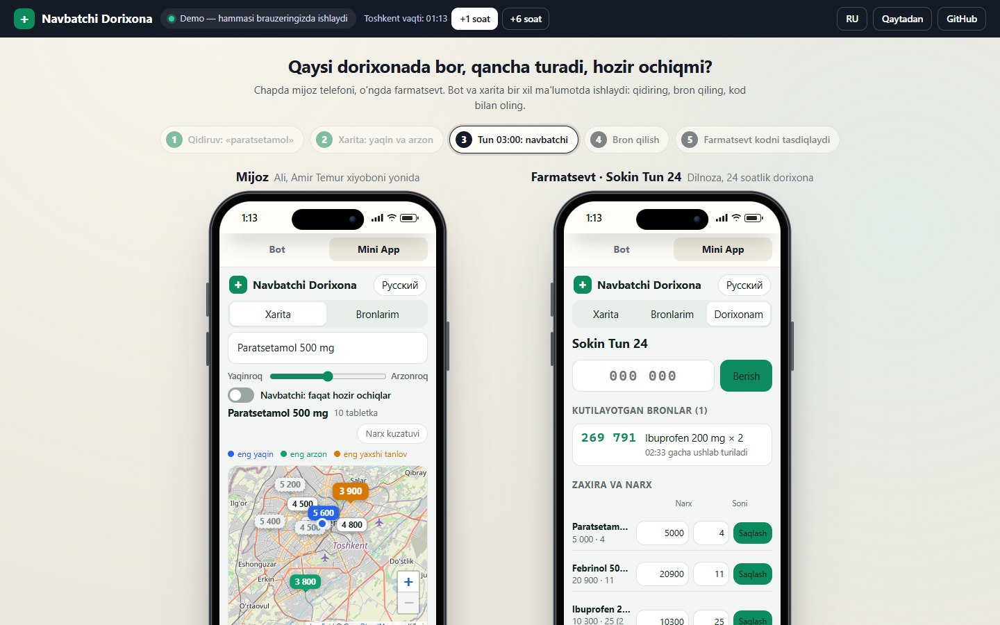
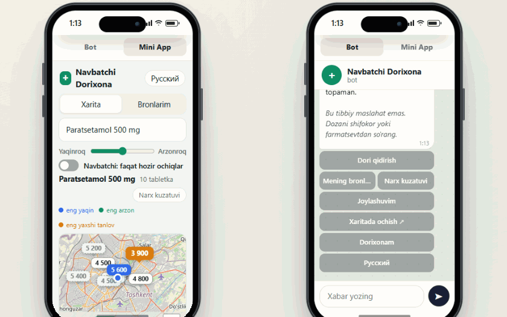
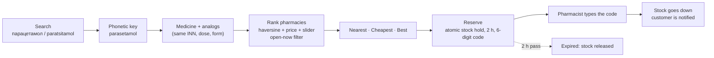

# Navbatchi Dorixona

**English** · [O'zbekcha](README.uz.md)

[](https://github.com/xoliddev/navbatchi-dorixona/actions/workflows/ci.yml)
[](https://xoliddev.github.io/navbatchi-dorixona/)
[](LICENSE)


"Navbatchi dorixona" means *the on-duty pharmacy*. It is a Telegram **bot + Mini App with a map** that answers
three questions at once: **which pharmacy nearby has this medicine, how much does it cost there, and is it open
right now?**

**The wow moment:** the map shows the **nearest** pharmacy and the **cheapest** one at the same time, plus a
**best choice** that trades distance against price. A slider decides what matters more to you. The
**"navbatchi" filter** hides everything that is closed, so it still helps at 3 a.m.

**[Live demo →](https://xoliddev.github.io/navbatchi-dorixona/)** a customer's phone and a pharmacist's phone
side by side. Everything runs in your browser.



<p align="center"></p>

## Features

- **Search that forgives how people really type.** Latin or Cyrillic, Uzbek or Russian spelling, typos:
  `парацетамол`, `paratsetamol`, `paracetamol` and `paratsitamol` all find the same medicine. Every name is folded
  to a phonetic key, then matched exactly, by prefix or with a small edit distance.
- **Brand ↔ active ingredient.** A brand is also found by its ingredient (INN). When you open a brand, cheaper
  generics with the same ingredient, dose and form are shown as **"arzonroq analog"** (cheaper analog).
- **Location.** Share your location in the bot, use the phone's geolocation in the Mini App, or just pick a
  district. Distance is computed with the haversine formula.
- **Ranking.** Distance and price are both scaled to 0..1000 and mixed by the slider (whole numbers only, so the
  Python server and the JS demo always agree). Nearest and cheapest are always shown, even when they rank lower.
- **Pharmacy card.** Address, hours, open-now state in Asia/Tashkent time (also past midnight and with days off),
  phone as plain text, stock level, price and "updated 25 min ago".
- **Reserve for pickup (bron).** Up to 5 packs are held for 2 hours with a 6-digit pickup code. The pharmacist
  types the code and the packs leave the shelf; otherwise the hold expires and the stock goes back on sale.
  **No overselling:** one conditional `UPDATE` inside `BEGIN IMMEDIATE`, plus `CHECK (reserved <= qty)` in SQLite.
  Prescription medicines (`rx`) cannot be reserved and say "retsept bilan".
- **Pharmacist panel** (bot menu and Mini App tab), for their own pharmacy only: stock and price, bulk CSV
  import (from Excel or Google Sheets), CSV export, waiting reservations, give out by code.
  An admin adds pharmacies and links pharmacists with single-use invite links.
- **Price alerts.** "Tell me when X is in stock within N km, or under P so'm." A scheduler loop fires each alert
  exactly once, even across restarts.
- **Buttons only.** `/start` is the only command; every screen has "⬅️ Orqaga" (Back). Uzbek by default,
  Russian with one tap. Every result says clearly that this is **not medical advice**.

All pharmacies, addresses, phone numbers and brand names are **fictional**. Medicines use real generic (INN) names;
prices are realistic but invented. Money is always a whole number of so'm.

## How it works



```mermaid
sequenceDiagram
    participant U as Customer
    participant API as Bot / Mini App API
    participant DB as SQLite (WAL)
    participant P as Pharmacist
    U->>API: reserve 2 × Paracetamol at pharmacy #2
    API->>DB: BEGIN IMMEDIATE; UPDATE stock SET reserved = reserved + 2 WHERE qty - reserved >= 2
    DB-->>API: 1 row (or 0: sold out, nothing held)
    API-->>U: pickup code 482 913, held until 05:00
    API-->>P: new reservation 482 913
    P->>API: code 482 913
    API->>DB: status = picked; qty -= 2; reserved -= 2
    API-->>U: handed over
```

The **pure core** (`navbatchi/core/`) has no I/O: transliteration and search, haversine, opening hours, ranking,
reservation rules, alerts, CSV and the seed generator. It is ported line by line to JavaScript (`shared/*.js`),
and **shared test vectors** (`shared/test_vectors.json`) are checked by both pytest and `node --test`, so the bot,
the Mini App and the browser demo give exactly the same answers.

## Run it on Windows in 10 minutes

Install Python 3.12 or newer from [python.org](https://www.python.org/downloads/) (tick **"Add python.exe to PATH"**).

1. **Create a bot.** In Telegram open [@BotFather](https://t.me/BotFather), send `/newbot`, choose a name and a
   username ending in `bot`. Copy the token it gives you.
2. **Get the code.** Download the ZIP and unpack it (or `git clone https://github.com/xoliddev/navbatchi-dorixona`).
   Open PowerShell in that folder.
3. **Settings.** Copy the example file and paste your token into `.env`:
   ```powershell
   Copy-Item .env.example .env
   notepad .env
   ```
   To use the admin menu, put your Telegram user id in `ADMIN_IDS` (ask [@userinfobot](https://t.me/userinfobot)).
4. **Install and run.**
   ```powershell
   py -m venv .venv
   .venv\Scripts\Activate.ps1
   pip install -r requirements.txt
   python -m navbatchi
   ```
   Open your bot in Telegram and press **Start**, then type `paratsetamol`. The bot works right away with the
   fictional demo city (`SEED_DEMO=1`).

### Open the Mini App (the map)

Telegram opens Mini Apps only over HTTPS. On your own computer the easiest free way is a Cloudflare tunnel:

```powershell
winget install --id Cloudflare.cloudflared
cloudflared tunnel --url http://localhost:8080
```

It prints an address like `https://something.trycloudflare.com`. Add `/webapp/` to it, put it in `.env` and restart:

```
WEBAPP_URL=https://something.trycloudflare.com/webapp/
```

The bot sets its menu button to the map, and the main menu gets a "Xaritada ochish" (open the map) button.

### Or with Docker

```powershell
Copy-Item .env.example .env   # then put your token into .env
docker compose up -d --build
```

The container runs as a non-root user on a read-only file system with all capabilities dropped; the database lives
in the `dorixona-data` volume.

## Settings (`.env`)

| Variable | Default | What it does |
|---|---|---|
| `BOT_TOKEN` | — (required) | Token from @BotFather |
| `WEBAPP_URL` | empty | HTTPS address of the Mini App, ending in `/webapp/` |
| `ADMIN_IDS` | empty | Telegram ids of admins (add pharmacies, invite pharmacists) |
| `DB_PATH` | `data/dorixona.db` | SQLite file (WAL mode) |
| `SEED_DEMO` | `1` | Fill an empty database with the fictional demo city |
| `HOST` / `PORT` | `0.0.0.0` / `8080` | Web server for the Mini App and its API |
| `INITDATA_MAX_AGE` | `3600` | Mini App login data older than this (seconds) is refused |
| `RATE_PER_MINUTE` | `30` | Actions per user per minute (bot and API) |
| `SCHEDULER_INTERVAL` | `30` | How often holds expire and alerts are checked (seconds) |
| `INVITE_HOURS` | `72` | Pharmacist invite links expire after this many hours |
| `LOG_LEVEL` | `INFO` | Log level |

## Security

- **Mini App login:** every API call carries Telegram `initData`; the server checks its HMAC-SHA256 with the bot
  token and refuses data older than `INITDATA_MAX_AGE` (or from the future).
- **Roles on every endpoint:** customer, pharmacist, admin. A pharmacist's pharmacy is looked up in the database on
  every call and never taken from the request, so pharmacist A cannot touch pharmacy B (tested).
- **Stock integrity:** atomic conditional update in a write transaction, `CHECK` constraints, a unique index on held
  pickup codes per pharmacy, and a test with two buyers racing for the last pack across two connections.
- **Input validation:** length limits everywhere, whole numbers only (floats and booleans refused), coordinates
  range-checked, request bodies capped, parameterised SQL only.
- **Buttons are not trusted:** callback data is parsed and filtered (known medicine ids, districts, slider values);
  anything else gets "this button is outdated". The service re-checks permissions on every action.
- **CSV hardened:** 64 KB and 500 rows max, strict header, whole numbers, per-line errors; exports neutralise
  spreadsheet formulas (`=`, `+`, `-`, `@` get a leading `'`).
- **Invites:** `secrets.token_urlsafe(16)`, only the SHA-256 is stored, single use, expire after 72 hours.
- **Per-user rate limits** in the bot and the API; strict CSP, `nosniff` and `no-referrer` headers.
- **Config only from env;** `.env.example` holds placeholders only. Non-root Docker container.

## Folders

```
navbatchi/core/    pure logic, no I/O: search, geo, hours, ranking, reservations, alerts, CSV, money, seed
navbatchi/         service (rules and roles), SQLite, initData check, scheduler, aiohttp API
navbatchi/bot/     aiogram 3 handlers and screens (buttons only)
shared/            JS port of the core + locales (uz, ru) + catalog data + shared test vectors
webapp/            Mini App: plain HTML, CSS and JS, Leaflet 1.9.4 vendored, no build step
demo/              GitHub Pages demo: two phones, simulated bot and an in-browser backend
tests/ js-tests/   pytest (core, service, concurrency, bot end-to-end, API) and node --test (parity, demo)
```

## Tests

```powershell
pip install -r requirements-dev.txt
ruff check .
pytest                                  # core vectors, service, races, bot with a mocked Bot API, API auth
node --test js-tests/*.test.mjs         # JS port on the same vectors; the demo over 30 days and New Year
npm i --no-save playwright; $env:PW_CHANNEL="chrome"; node scripts/e2e.mjs   # the demo in a real browser
```

## License

[MIT](LICENSE) © 2026 xoliddev. Map data © OpenStreetMap contributors. Leaflet is BSD-2-Clause.
