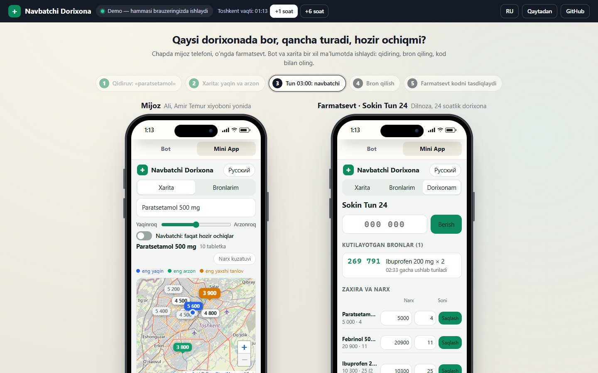
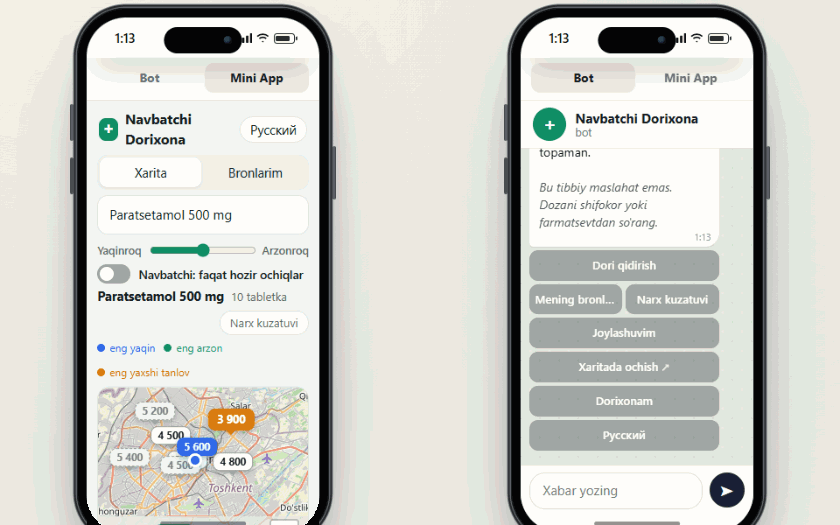
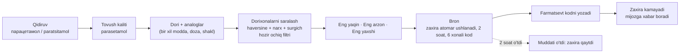

# Navbatchi Dorixona

[English](README.md) · **O'zbekcha**

[](https://github.com/xoliddev/navbatchi-dorixona/actions/workflows/ci.yml)
[](https://xoliddev.github.io/navbatchi-dorixona/)
[](LICENSE)


Telegram **bot + xaritali Mini App**. U uchta savolga birdan javob beradi: **dori yaqin atrofdagi qaysi dorixonada
bor, u yerda qancha turadi va dorixona hozir ochiqmi?**

**Eng qizig'i:** xaritada **eng yaqin** dorixona va **eng arzon** dorixona bir vaqtda ko'rinadi. Ular orasida
masofa va narxni tortishib chiqadigan **"eng yaxshi tanlov"** ham bor. Nima muhimroq ekanini surgich (slider) bilan
o'zingiz tanlaysiz. **"Navbatchi" filtri** yopiq dorixonalarni yashiradi, shuning uchun tungi soat 3 da ham ish beradi.

**[Jonli demo →](https://xoliddev.github.io/navbatchi-dorixona/)** mijoz telefoni va farmatsevt telefoni
yonma-yon. Hammasi brauzeringizda ishlaydi.



<p align="center"></p>

## Imkoniyatlar

- **Odamlar qanday yozsa, shunday topadigan qidiruv.** Lotin yoki kirill, o'zbekcha yoki ruscha yozilish, xatolar:
  `парацетамол`, `paratsetamol`, `paracetamol` va `paratsitamol` — hammasi bitta dorini topadi. Har bir nom
  "tovush kaliti"ga aylantiriladi, keyin aynan, boshlanishi bo'yicha yoki kichik xato bilan solishtiriladi.
- **Brend ↔ ta'sir qiluvchi modda.** Brend o'z moddasi (INN) bo'yicha ham topiladi. Brendni ochsangiz, moddasi,
  dozasi va shakli bir xil bo'lgan arzonroq dorilar **"arzonroq analog"** deb ko'rsatiladi.
- **Joylashuv.** Botda joylashuvni yuborasiz, Mini App'da telefon geolokatsiyasi ishlaydi yoki shunchaki tumanni
  tanlaysiz. Masofa haversine formulasi bilan hisoblanadi.
- **Saralash.** Masofa ham, narx ham 0..1000 oralig'iga keltiriladi va surgich bo'yicha aralashtiriladi (faqat
  butun sonlar, shuning uchun Python server va JS demo doim bir xil javob beradi). Eng yaqin va eng arzon dorixona
  ro'yxatda pastroqda bo'lsa ham, doim ko'rsatiladi.
- **Dorixona kartasi.** Manzil, ish vaqti, Toshkent vaqti bo'yicha hozir ochiqligi (yarim tundan keyin ishlaydigan
  va dam olish kuni bor dorixonalar ham), telefon oddiy matn sifatida, qoldiq, narx va "25 daqiqa oldin yangilangan".
- **Olib ketish uchun bron.** 5 tagacha quti 2 soat ushlab turiladi, 6 xonali olib ketish kodi beriladi.
  Farmatsevt kodni yozadi va dori javondan chiqadi; aks holda muddat tugaydi va dori yana sotuvga qaytadi.
  **Ortiqcha sotilmaydi:** `BEGIN IMMEDIATE` ichida bitta shartli `UPDATE`, SQLite'da esa `CHECK (reserved <= qty)`.
  Retsept bilan beriladigan dorilarni (`rx`) bron qilib bo'lmaydi, ularda "retsept bilan" yozuvi chiqadi.
- **Farmatsevt paneli** (bot menyusi va Mini App bo'limi), faqat o'z dorixonasi uchun: zaxira va narx, Excel yoki
  Google Sheets'dan CSV bilan ommaviy yuklash, CSV yuklab olish, kutilayotgan bronlar, kod bilan berish.
  Admin dorixona qo'shadi va farmatsevtlarni bir martalik havola bilan ulaydi.
- **Narx kuzatuvi.** "X dori N km ichida paydo bo'lsa yoki P so'mdan arzon bo'lsa, xabar ber." Rejalashtiruvchi
  sikl har bir kuzatuvni aynan bir marta yuboradi, server qayta ishga tushsa ham.
- **Faqat tugmalar.** Yagona buyruq — `/start`; har bir ekranda "⬅️ Orqaga" bor. Odatiy til o'zbekcha, bitta
  bosish bilan ruscha. Har bir natijada bu **tibbiy maslahat emasligi** aniq yozilgan.

Barcha dorixonalar, manzillar, telefonlar va brend nomlari **to'qima**. Dorilar haqiqiy xalqaro (INN) nomlarda,
narxlar real ko'rinadi, lekin o'ylab topilgan. Pul doim butun so'mda saqlanadi.

## Qanday ishlaydi



```mermaid
sequenceDiagram
    participant U as Mijoz
    participant API as Bot / Mini App API
    participant DB as SQLite (WAL)
    participant P as Farmatsevt
    U->>API: 2 × Paratsetamol, 2-dorixonada bron
    API->>DB: BEGIN IMMEDIATE; UPDATE stock SET reserved = reserved + 2 WHERE qty - reserved >= 2
    DB-->>API: 1 qator (yoki 0: tugagan, hech narsa ushlanmaydi)
    API-->>U: olib ketish kodi 482 913, 05:00 gacha
    API-->>P: yangi bron 482 913
    P->>API: kod 482 913
    API->>DB: status = picked; qty -= 2; reserved -= 2
    API-->>U: berildi
```

**Sof yadro** (`navbatchi/core/`) tashqi dunyoga murojaat qilmaydi: transliteratsiya va qidiruv, haversine, ish
vaqti, saralash, bron qoidalari, kuzatuv, CSV va boshlang'ich ma'lumot generatori. U JavaScript'ga qatorma-qator
ko'chirilgan (`shared/*.js`), **umumiy test vektorlari** (`shared/test_vectors.json`) esa pytest va `node --test`
tomonidan tekshiriladi. Shuning uchun bot, Mini App va brauzerdagi demo aynan bir xil javob beradi.

## Windows'da 10 daqiqada ishga tushirish

[python.org](https://www.python.org/downloads/) dan Python 3.12 yoki yangisini o'rnating
(**"Add python.exe to PATH"** belgisini qo'ying).

1. **Bot yarating.** Telegram'da [@BotFather](https://t.me/BotFather) ni oching, `/newbot` yuboring, nom va
   oxiri `bot` bilan tugaydigan username tanlang. Bergan tokenni nusxalab oling.
2. **Kodni oling.** ZIP'ni yuklab, oching (yoki `git clone https://github.com/xoliddev/navbatchi-dorixona`).
   O'sha papkada PowerShell'ni oching.
3. **Sozlamalar.** Namuna faylni nusxalang va tokenni `.env` ga qo'ying:
   ```powershell
   Copy-Item .env.example .env
   notepad .env
   ```
   Admin menyusi kerak bo'lsa, `ADMIN_IDS` ga o'z Telegram id raqamingizni yozing
   ([@userinfobot](https://t.me/userinfobot) aytib beradi).
4. **O'rnatib, ishga tushiring.**
   ```powershell
   py -m venv .venv
   .venv\Scripts\Activate.ps1
   pip install -r requirements.txt
   python -m navbatchi
   ```
   Telegram'da botingizni ochib **Start** ni bosing va `paratsetamol` deb yozing. Bot darhol to'qima demo shahar
   bilan ishlaydi (`SEED_DEMO=1`).

### Mini App'ni (xaritani) ochish

Telegram Mini App'ni faqat HTTPS orqali ochadi. O'z kompyuteringizda eng oson bepul yo'l — Cloudflare tunneli:

```powershell
winget install --id Cloudflare.cloudflared
cloudflared tunnel --url http://localhost:8080
```

U `https://nimadir.trycloudflare.com` kabi manzil chiqaradi. Oxiriga `/webapp/` qo'shib `.env` ga yozing va
botni qayta ishga tushiring:

```
WEBAPP_URL=https://nimadir.trycloudflare.com/webapp/
```

Bot menyu tugmasini xaritaga ulaydi, bosh menyuda esa "Xaritada ochish" tugmasi chiqadi.

### Yoki Docker bilan

```powershell
Copy-Item .env.example .env   # keyin .env ga tokenni yozing
docker compose up -d --build
```

Konteyner root bo'lmagan foydalanuvchi bilan, faqat o'qiladigan fayl tizimida, barcha qo'shimcha huquqlarsiz
ishlaydi; baza `dorixona-data` hajmida turadi.

## Sozlamalar (`.env`)

| O'zgaruvchi | Odatiy qiymat | Vazifasi |
|---|---|---|
| `BOT_TOKEN` | — (majburiy) | @BotFather bergan token |
| `WEBAPP_URL` | bo'sh | Mini App'ning HTTPS manzili, oxiri `/webapp/` |
| `ADMIN_IDS` | bo'sh | Adminlarning Telegram id raqamlari (dorixona qo'shadi, farmatsevt ulaydi) |
| `DB_PATH` | `data/dorixona.db` | SQLite fayli (WAL rejimi) |
| `SEED_DEMO` | `1` | Bo'sh bazani to'qima demo shahar bilan to'ldirish |
| `HOST` / `PORT` | `0.0.0.0` / `8080` | Mini App va uning API'si uchun veb-server |
| `INITDATA_MAX_AGE` | `3600` | Bundan eski (soniya) Mini App kirish ma'lumoti rad etiladi |
| `RATE_PER_MINUTE` | `30` | Bir foydalanuvchining daqiqasiga amallari (bot va API) |
| `SCHEDULER_INTERVAL` | `30` | Bron muddati va narx kuzatuvi qancha vaqtda bir tekshiriladi (soniya) |
| `INVITE_HOURS` | `72` | Farmatsevt havolasi necha soatdan keyin eskiradi |
| `LOG_LEVEL` | `INFO` | Log darajasi |

## Xavfsizlik

- **Mini App kirishi:** har bir API so'rovida Telegram `initData` bor; server uning HMAC-SHA256 imzosini bot tokeni
  bilan tekshiradi va `INITDATA_MAX_AGE` dan eski (yoki kelajak sanali) ma'lumotni rad etadi.
- **Har bir manzilda rol tekshiruvi:** mijoz, farmatsevt, admin. Farmatsevtning dorixonasi har safar bazadan olinadi,
  so'rovdan hech qachon olinmaydi: A dorixona farmatsevti B dorixonaga tegolmaydi (test bilan tekshirilgan).
- **Zaxira butunligi:** yozish tranzaksiyasi ichida atomar shartli yangilash, `CHECK` cheklovlari, har bir
  dorixonada ushlangan kodlar uchun noyob indeks va oxirgi quti uchun ikki xaridor poygasi testi (ikki ulanishda).
- **Kiritishni tekshirish:** hamma joyda uzunlik chegarasi, faqat butun sonlar (kasr va true/false rad etiladi),
  koordinatalar oralig'i tekshiriladi, so'rov tanasi cheklangan, SQL faqat parametrlar bilan.
- **Tugmaga ishonilmaydi:** callback ma'lumoti tekshiriladi (ma'lum dori id'lari, tumanlar, surgich qiymatlari),
  boshqasiga "bu tugma eskirgan" deyiladi. Servis har bir amalda ruxsatni qayta tekshiradi.
- **CSV himoyalangan:** ko'pi bilan 64 KB va 500 qator, qat'iy sarlavha, butun sonlar, har qator bo'yicha xato;
  eksportda jadval formulalari zararsizlantiriladi (`=`, `+`, `-`, `@` oldiga `'` qo'yiladi).
- **Havolalar:** `secrets.token_urlsafe(16)`, bazada faqat SHA-256, bir martalik, 72 soatda eskiradi.
- **Tezlik cheklovi** har bir foydalanuvchiga, bot va API'da; qat'iy CSP, `nosniff` va `no-referrer` sarlavhalari.
- **Sozlamalar faqat env'dan;** `.env.example` da faqat namuna qiymatlar. Docker konteyneri root'siz ishlaydi.

## Papkalar

```
navbatchi/core/    sof mantiq: qidiruv, geo, ish vaqti, saralash, bron, kuzatuv, CSV, pul, boshlang'ich ma'lumot
navbatchi/         servis (qoidalar va rollar), SQLite, initData tekshiruvi, rejalashtiruvchi, aiohttp API
navbatchi/bot/     aiogram 3 handlerlari va ekranlari (faqat tugmalar)
shared/            yadroning JS nusxasi + til fayllari (uz, ru) + katalog ma'lumotlari + umumiy test vektorlari
webapp/            Mini App: oddiy HTML, CSS va JS, Leaflet 1.9.4 ichida, yig'ish bosqichi yo'q
demo/              GitHub Pages demosi: ikki telefon, simulyatsiya qilingan bot va brauzer ichidagi backend
tests/ js-tests/   pytest (yadro, servis, poyga, botning to'liq oqimi, API) va node --test (moslik, demo)
```

## Testlar

```powershell
pip install -r requirements-dev.txt
ruff check .
pytest                                  # yadro vektorlari, servis, poyga, soxta Bot API bilan bot, API kirishi
node --test js-tests/*.test.mjs         # JS nusxasi o'sha vektorlar bilan; demo 30 kun va Yangi yil bo'yicha
npm i --no-save playwright; $env:PW_CHANNEL="chrome"; node scripts/e2e.mjs   # demo haqiqiy brauzerda
```

## Litsenziya

[MIT](LICENSE) © 2026 xoliddev. Xarita ma'lumotlari © OpenStreetMap mualliflari. Leaflet — BSD-2-Clause.
